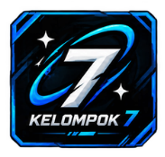

  

<h1>KELOMPOK 7</h1>

<h3>DEVELOP • COLLABORATE • INNOVATE</h3>

  Welcome to our team repository!

---

## About Us

Kami adalah kelompok 7 dari mata kuliah Rekayasa Perangkat Lunak.

## Our Team

| Nama | Role |
|---|---|
| supendi (240504119) | ketua kelompok |
| difa hani sakila (240504130) | sekretaris |
| mardhatilla (250504131) | programmer |
| ridho agung sadiva (240504117) | UI/UX designer |

## Technologies

- HTML
- CSS
- JavaScript
- Git & GitHub
- 

  

  <h2>SISTEM INFORMASI MANAJEMEN KOS</h2>
  
<b>KELOMPOK 7 | REKAYASA PERANGKAT LUNAK</b>

  
Kelola Kos Lebih Mudah, Praktis dan Modern

---

## About Project

Kami adalah Kelompok 7 dari mata kuliah Rekayasa Perangkat Lunak. Kami mengembangkan sebuah Sistem Informasi Manajemen Kos Berbasis Web menggunakan Laravel dan MySQL.

Project ini bertujuan untuk membantu pemilik kos dalam mengelola data kamar, penghuni, pembayaran, serta informasi kos secara lebih mudah, cepat, dan terstruktur.

## Our Team

| Nama | NIM | Role |
|---|---|---|
| Supendi | 240504119 | Ketua Project |
| Difa Hani Sakila | 250504130 | Sekretaris |
| Mardhatilla | 250504131 | Programmer |
| Ridho Agung Sadiva | 240504117 | UI/UX Designer |

## Project Objectives

1. Mempermudah pengelolaan data penghuni kos.
2. Membantu pengelolaan informasi kamar.
3. Mempermudah pencatatan pembayaran sewa.
4. Mengurangi kesalahan pencatatan administrasi.
5. Menyediakan informasi kos secara terstruktur.

## Main Features

- Manajemen data kamar kos.
- Manajemen data penghuni.
- Pencatatan pembayaran sewa.
- Pengelolaan informasi kos.
- Laporan administrasi kos.

## Technologies

- PHP
- Laravel
- MySQL
- HTML
- CSS
- JavaScript
- Git & GitHub

## Project Information

**Project Name:** Sistem Informasi Manajemen Kos

**Project Type:** Web-Based Application

**Framework:** Laravel

**Database:** MySQL

**Repository:** sistem-informasi-manajemen-kos

---

<h1 align="center">PROJECT CHARTER</h1>

  

  <h3>KELOMPOK 7</h3>
  
DEVELOP • COLLABORATE • INNOVATE

  
Universitas Samudera

---
## SISTEM INFORMASI MANAJEMEN KOS
**Kelompok 7 – Rekayasa Perangkat Lunak**

### 1. Latar Belakang Proyek
Sistem Informasi Manajemen Kos merupakan sebuah sistem berbasis web yang dirancang untuk membantu pemilik kos dalam mengelola data kamar, penghuni, pembayaran, dan informasi kos secara lebih mudah dan terorganisir.

Pengelolaan kos yang masih dilakukan secara manual dapat menyebabkan kesulitan dalam pencatatan data penghuni, pemantauan ketersediaan kamar, serta pengelolaan pembayaran. Oleh karena itu, diperlukan sistem informasi yang dapat membantu meningkatkan efisiensi dan ketepatan pengelolaan kos.

### 2. Tujuan Proyek
Tujuan dari pengembangan sistem ini adalah:
- Mempermudah pemilik kos dalam mengelola data penghuni.
- Membantu pencatatan data kamar dan ketersediaannya.
- Mempermudah pengelolaan pembayaran sewa kos.
- Mengurangi kesalahan pencatatan secara manual.
- Menyediakan informasi kos secara terstruktur dan mudah diakses.

### 3. Ruang Lingkup Proyek
Ruang lingkup pengembangan Sistem Informasi Manajemen Kos meliputi:

**A. Fitur Utama**
- Login dan logout pengguna.
- Pengelolaan data kamar kos.
- Pengelolaan data penghuni.
- Pengelolaan pembayaran kos.
- Informasi status kamar.
- Laporan pengelolaan kos.

**B. Batasan Proyek**
Sistem difokuskan pada pengelolaan informasi dan administrasi kos berbasis web. Pengembangan fitur tambahan dapat dilakukan sesuai kebutuhan proyek.

### 4. Teknologi yang Digunakan
Teknologi yang direncanakan dalam pengembangan sistem:
- HTML: Membuat struktur halaman web.
- CSS: Mengatur tampilan website.
- JavaScript: Menambahkan interaksi halaman.
- PHP: Bahasa pemrograman backend.
- Laravel: Framework pengembangan aplikasi.
- MySQL: Mengelola database.
- Git dan GitHub: Mengelola kode program dan kolaborasi tim.

### 5. Struktur Tim Proyek

| Nama Anggota | NIM | Jabatan |
|---|---|---|
| Supendi | 240504119 | Ketua Kelompok |
| Difa Hani Sakila | 250504130 | Sekretaris |
| Mardhatilla | 250504131 | Programmer |
| Ridho Agung Sadiva | 240504117 | UI/UX Designer |

### 6. Tugas dan Tanggung Jawab
- **Ketua Kelompok:** Mengkoordinasikan anggota dan mengawasi jalannya proyek.
- **Sekretaris:** Menyusun dokumentasi dan mencatat perkembangan proyek.
- **Programmer:** Mengembangkan fitur dan menulis kode program.
- **UI/UX Designer:** Merancang tampilan dan pengalaman pengguna sistem.

### 7. Hasil yang Diharapkan
Hasil akhir dari proyek ini adalah sebuah Sistem Informasi Manajemen Kos berbasis web yang dapat membantu pemilik kos dalam mengelola data kamar, penghuni, pembayaran, dan laporan secara terstruktur.

### 8. Jadwal Pelaksanaan
Tahapan pelaksanaan proyek meliputi:
1. Perencanaan proyek.
2. Analisis kebutuhan sistem.
3. Perancangan sistem dan database.
4. Pembuatan desain antarmuka.
5. Implementasi program.
6. Pengujian sistem.
7. Evaluasi dan penyelesaian proyek.

*Tanggal pelaksanaan setiap tahapan disesuaikan dengan jadwal kelompok.*

### 9. Risiko Proyek
Beberapa risiko yang mungkin terjadi selama pengembangan:
- Keterlambatan penyelesaian program.
- Kesalahan dalam penulisan kode.
- Kesulitan dalam mengintegrasikan database.
- Kurangnya koordinasi antaranggota.
- Fitur sistem belum berjalan sesuai kebutuhan.

**Solusi:** Melakukan komunikasi secara rutin, pembagian tugas yang jelas, pengujian program, dan evaluasi secara berkala.

### 10. Kesimpulan
Project Charter ini menjadi pedoman awal bagi Kelompok 7 dalam mengembangkan Sistem Informasi Manajemen Kos. Dengan adanya dokumen ini, setiap anggota diharapkan memahami tujuan, ruang lingkup, tanggung jawab, dan tahapan pelaksanaan proyek sehingga pengembangan sistem dapat berjalan secara terarah dan terorganisir.

